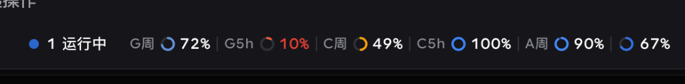
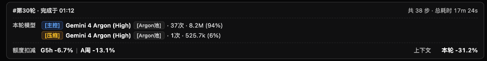
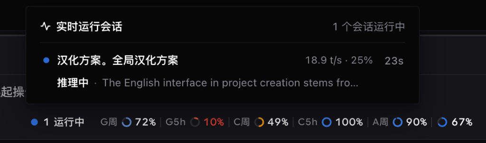
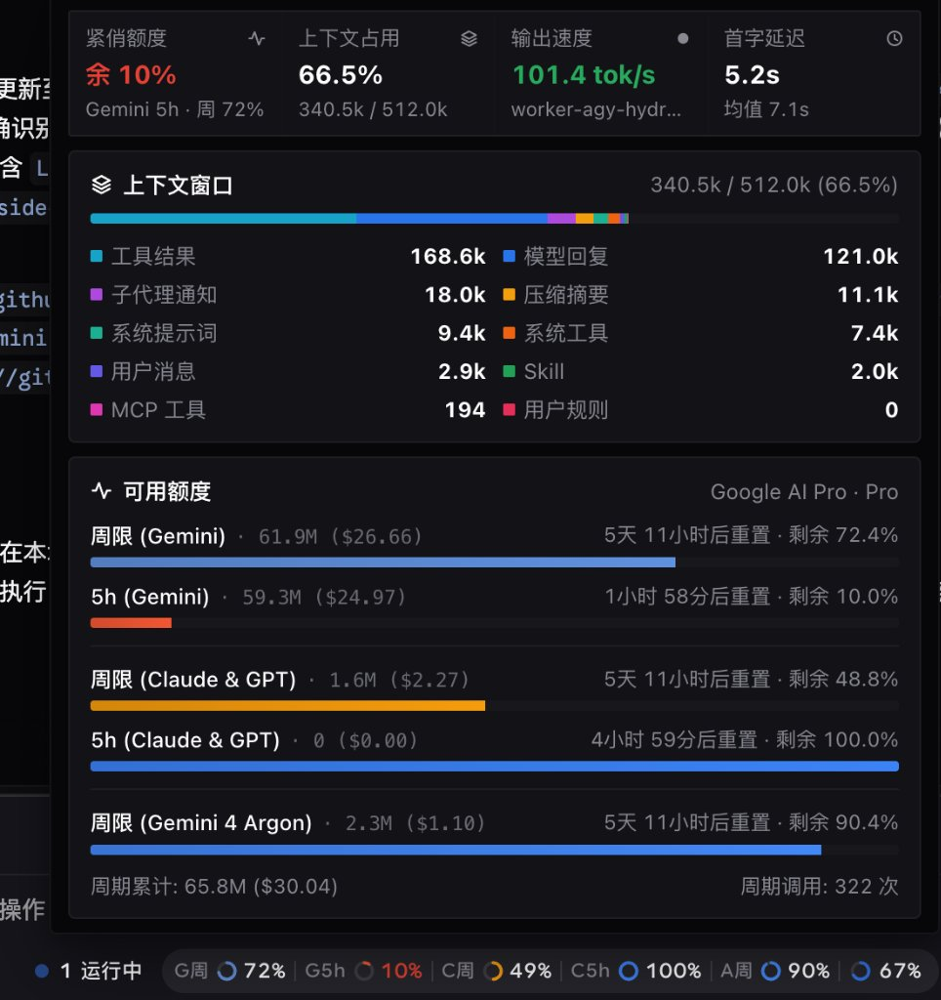

<div align="center">


# Antigravity Usage & Speed Monitor (Gemini Custom Edition)

Local usage, speed, context, and quota monitor for Google Antigravity 2.0, Antigravity IDE, and Antigravity CLI (derived from [`yuhuan-dev/antigravity-usage-monitor`](https://github.com/yuhuan-dev/antigravity-usage-monitor)), with no external npm dependencies.

[](https://github.com/tiantutu798-bit/Gemini/stargazers)
[](LICENSE)
[](#local-development)
[](#client-support)

**English** · [简体中文完整介绍 (README.zh-CN.md)](README.zh-CN.md)

[**✨ Key Innovations (Pinned)**](#highlighted-innovations-pinned) · [4 Core Screenshots](#1-live-showcase-4-core-screenshots) · [6-Slot Composer Bar](#2-permanent-6-slot-composer-quota-bar) · [Remaining Gradient](#3-remaining-first-bars--continuous-blueamberred-gradient) · [Per-Turn Inline Card](#4-per-turn-inline-usage-summary-card-in-chat-stream) · [Installation](#installation) · [Features](#features) · [Development](#local-development)

<br />



<br />

[Download Source ZIP (`main.zip`)](https://github.com/tiantutu798-bit/Gemini/archive/refs/heads/main.zip) · [Upstream Repository (`yuhuan-dev/antigravity-usage-monitor`)](https://github.com/yuhuan-dev/antigravity-usage-monitor)

</div>

---

<a id="highlighted-innovations-pinned"></a>

## ✨ Highlighted Innovations (Pinned)

> [!IMPORTANT]
> This repository is a **GNU GPL v3.0-only derivative fork** of [`yuhuan-dev/antigravity-usage-monitor`](https://github.com/yuhuan-dev/antigravity-usage-monitor) (`v1.5.1`), modified on 2026-11. All upstream copyright notices, full Git commit history, and GPL-3.0-only licensing terms are preserved intact while introducing the core UX and visual upgrades highlighted below.

### 1. Live Showcase (4 Core Screenshots)

<table>
  <tr>
    <td align="center">
      
      <br />
      <b>① Permanent 6-Slot Composer Quota Bar (Synced Color Rings)</b>
      <br />
      <sub>Docked inside the chat input bar with zero tab-switching: displays <code>G周 72%</code> | <code>G5h 10%</code> | <code>C周 49%</code> | <code>C5h 100%</code> | <code>A周 90%</code> | <code>Context 67%</code> in one glance</sub>
    </td>
  </tr>
  <tr>
    <td align="center">
      
      <br />
      <b>② Per-Turn Inline Usage Summary Card Below Every Response</b>
      <br />
      <sub>Automatically mounted at the bottom of each completed turn: breaks down <code>[Main]</code> / <code>[Exec]</code> / <code>[Subagent]</code> / <code>[Compact]</code> model calls & token shares, exact quota pool deductions (e.g., <code>G5h -6.7% | A周 -13.1%</code>), and net context delta (e.g., <code>-31.2%</code> after auto-compaction)</sub>
    </td>
  </tr>
  <tr>
    <td align="center">
      
      <br />
      <b>③ Live Running-Sessions HUD Above the Composer Bar</b>
      <br />
      <sub>Hovering/clicking the left active badge opens live generation throughput (<code>18.9 t/s</code>), phase, and elapsed time directly above the composer without obscuring the 6 quota slots</sub>
    </td>
  </tr>
  <tr>
    <td align="center">
      
      <br />
      <b>④ Hover Overview Card · Official Ordering, Remaining Bars & Synced Gradient</b>
      <br />
      <sub>Matches Official Usage ordering (Gemini Weekly/5h → Claude & GPT Weekly/5h → Argon Weekly) with remaining-based bar lengths and 1:1 synced blue→amber→red colors across bars and composer rings</sub>
    </td>
  </tr>
</table>

### 2. Permanent 6-Slot Composer Quota Bar

Unlike upstream (which caps slots at 5 text-only items and lacks an `Argon Weekly` slot), this edition redesigns the composer bar for multi-pool workflows:

- **Expanded 5 → 6 Slots + `argon_weekly`**: Raised `MAX_TOPBAR_SLOTS` from `5` to **`6`** and added **`argon_weekly` (`A周` / `AWk`)**, fitting all 5 official quota windows plus live context usage in one composer row: `G周 | G5h | C周 | C5h | A周 | Context`.
- **Circular Quota Rings + No `52px` Clipping**: Embedded circular SVG progress rings matching the context indicator on all 5 quota tags and removed the hardcoded `52px` quota label width constraint so `100%` never truncates to ellipses.
- **Zero Context-Switching**: Stays permanently anchored left of the composer mode control without crowding the window titlebar or opening the Usage settings page.

<details>
<summary>Recommended 6-slot configuration (UI: Preferences → Structure, or settings.json)</summary>

```json
{
  "windowMountMode": "composer",
  "enableWindowOverlay": true,
  "topbarCapsuleSlots": [
    "gemini_weekly",
    "gemini_5h",
    "claude_weekly",
    "claude_5h",
    "argon_weekly",
    "context"
  ]
}
```

</details>

### 3. Remaining-First Bars & Continuous Blue–Amber–Red Gradient

To make remaining headroom readable in peripheral vision at a glance:

- **Bars Track Remaining % (Not Used %)**: [`QuotaPoolsWidget.js`](sidecars/panel/src/components/widgets/QuotaPoolsWidget.js) binds `--fill-w` directly to `remainingPct` (**100% remaining = full bar, 0% = empty**), and right-hand text displays remaining percentage only (`{reset} · {rem}% left`), matching the numeric rings below.
- **Continuous 5-Stop RGB Gradient**: Shared helper [`resolveQuotaRemainingColor()`](sidecars/panel/src/core/formatters.js) linearly interpolates across 5 color anchors and drives both `--fill-bg` bars and `--ring-color` composer rings identically:

| Remaining Quota | Hex Color | Visual Signal |
| :---: | :---: | :--- |
| **100%** | `#3b82f6` | Pure Primary Blue — Full headroom (e.g., `C5h ○ 100%`) |
| **75%** | `#4e8ff7` | Soft Blue — Early usage, healthy (e.g., `G周 ○ 72%`, `A周 ○ 90%`) |
| **50%** | `#f59e0b` | Warm Amber — Roughly half used (e.g., `C周 ○ 49%`) |
| **25%** | `#f97316` | Vivid Orange — Running low; check reset countdown |
| **0%** | `#ef4444` | Alert Red — Critically low headroom (e.g., `G5h ○ 10%`) |

- **Independent Context Ring**: The 6th context-usage ring (`○ 67%`) keeps its own semantic styling so context fill is never confused with quota headroom.

### 4. Per-Turn Inline Usage Summary Card in Chat Stream

In long multi-turn conversations, global totals or raw step tables make it difficult to tell which background models ran during a specific prompt and how much quota that single answer consumed. [`TurnUsageCardWidget.js`](sidecars/panel/src/components/widgets/TurnUsageCardWidget.js) injects a compact 3-row summary card directly beneath every completed AI response in the chat stream:

<p align="center">
  
</p>

- **Row 1 · Turn Identity & Total Duration**: Displays the exact turn index, completion timestamp (`#第30轮 · 完成于 01:12`), total model/tool steps, and cumulative wall-clock duration (`共 38 步 · 总耗时 17m 24s`).
- **Row 2 · Role-Tagged Model & Quota-Pool Breakdown**: Groups all calls in the turn by role badge (`[主控]` Main / `[执行]` Exec / `[子代理]` Subagent / `[压缩]` Compact) and quota pool (`[Argon池]` / `[Gemini池]` / `[Claude池]` / `[Carbon池]`), showing call counts, token throughput, and percentage share within the turn.
- **Row 3 · Per-Turn Quota Deduction & Net Context Delta**:
  - **Quota Deduction**: Computes the percentage drop across every quota pool touched by the turn (including `Gemini 4 Argon`'s dual-pool deduction across shared `G5h` and dedicated `A周`, e.g., `G5h -6.7% | A周 -13.1%`), complementing the live remaining percentages in the bottom composer bar.
  - **Context Net Delta**: Shows how much the main context window grew or shrank during the turn (e.g., `+4.8%` on normal turns, or `-31.2%` when an auto-compaction step frees context capacity).
- **Virtual-Scroll (`trajectorySlice`) Alignment & Streaming Suppression**: Matches DOM `[data-testid="agent-response"]` nodes against backend `recentSteps` via React Fiber `container.steps[].metadata.createdAt` timestamps so virtualized long chats always display their true turn number, and suppresses mounting while a turn is actively streaming.

### Full Diff Summary vs. Upstream

| Area | Upstream (`yuhuan-dev/antigravity-usage-monitor`) | This Edition (`tiantutu798-bit/Gemini`) |
| :--- | :--- | :--- |
| **Per-Turn Inline Summary** | None (requires opening popover step table; no per-turn quota drop calculation) | **3-row inline card below every completed response**: role/pool model breakdown, **per-turn quota drop (`G5h / G周 / A周 / C5h / C周`)**, and **net context delta** |
| **Composer Slots** | Up to 5 slots, no `argon_weekly`, fixed `52px` width clipping | **6 slots**, adds `argon_weekly`, SVG progress rings on all 5 quotas, no truncation |
| **Quota Card Order** | `Gemini → Argon → Claude & GPT`; `5h` above `Weekly` | **Matches Official Usage**: `Gemini → Claude & GPT → Argon`; **`Weekly` above `5h`** |
| **Bars & Meta Text** | Bar fills by `used %`, text shows both used and remaining | Bar fills by **`remaining %`**, text shows **remaining only** |
| **Color System** | Hard thresholds at 70%/85%; static ring styling | **Continuous blue (`#3b82f6`) → amber (`#f59e0b`) → red (`#ef4444`)** synced across bars and 5 composer rings |
| **Model Attribution** | `MODEL_PLACEHOLDER_M537` could fall back to `orchestrator-carbon` | Added [`pricing-catalog.json`](pricing-catalog.json) & formatter rules for **`Orchestrator (Neon)`** |
| **macOS 2.33.0+ Launch** | Manual relaunch needed if `--remote-debugging-port` is absent | Guarded `autoRelaunchDebug` opens macOS `Terminal`, verifies live bridge mount, waits 3s, and closes itself |
| **Manifest Name** | Default English manifest name | Localized [`plugin.json`](plugin.json) `displayName` (`用量与额度监控`) |

---

## Features

- **Live Metrics & Customizable Layout**: Tracks output speed (`tok/s`), time-to-first-token (`TTFT`), session average speed, step/session USD cost, cache hit rate, tightest remaining quota, and session tokens. You can choose and reorder the overview metric cards (4 shown by default out of 9 options) and section blocks.
- **10-Category Context Breakdown**: Shows the token breakdown of the latest request across assistant replies, tool results, user messages, subagent notifications, checkpoints, system prompts, system tools, MCP tools, skills, and user rules, with a switcher between the main agent and spawned subagents.
- **Quota Pool Tracking**: Reads 5-hour and weekly quotas, reset timers, and cycle consumption across `Gemini`, `Gemini 4 Argon`, `Gemini 4 Carbon`, and `Claude & GPT` pools, preserving cached pool status with a stale badge when upstream quota data is temporarily unavailable.
- **Main Agent, Subagents & Multi-Session Views**: Merges main agent and subagent steps in chronological order (or filters by individual agent), renders optional turn rails, expands running subagent tasks inline, and provides a recent-conversation selector in the header.
- **Call Details & Custom Token Formats**: Includes **By Step** and **By Model** tabs (with multi-model throughput charts). Supports 2–14 configurable columns, optional speed color grading, preset `Ctx / Think / Reply` and `In / Out / Cache` columns, and custom token combination strings such as `context:new:cache` or `in:out:cache`.
- **Historical Usage & Breakdowns**: Summarizes tokens, uncached input vs. cache-read savings, thinking/output split, hourly/daily trend curves, model rankings, client attribution (`Desktop App` / `IDE` / `CLI`), and monthly bar charts across `Today`, `1d`, `7d`, `14d`, `30d`, `All`, or custom date/time ranges.
- **Multi-Client Capsules & Hover Popover**: Integrates as a titlebar or composer capsule and auxiliary sidebar in Antigravity 2.0, a titlebar/composer capsule in Antigravity IDE, a single-line 24-bit ANSI `statusLine` in Antigravity CLI (`agy`), and a standalone local web UI. Supports 1–6 customizable capsule slots, configurable hover cards, and `Auto Fit` or fixed (`440–1080 px`) popover widths.
- **No `app.asar` Modification**: Titlebar/composer injection and context request hooks run in memory over local CDP (`DevToolsActivePort`). On Antigravity IDE, the only host file updated is adding `"remote-debugging-port": "0"` to `~/.antigravity-ide/argv.json`; installation binaries and `app.asar` are never altered.
- **Per-Model Context Windows**: Sets context window limits per model series (across thinking levels) or follows host defaults under Settings. Desktop/IDE applies rules at runtime on outbound requests; CLI applies `AGY_CLI_AUTO_COMPACT_OVERRIDE`.
- **Appearance, Offline Storage & Cloud Updates**: Supports `zh-CN` / `en-US` / host language, `sm / md / lg / xl` font scaling, 6 theme accents plus host matching, offline reading from CLI SQLite + WAL, `annotations/*.pbtxt`, `transcript.jsonl`, and `.deep_stats_cache.json`, GitHub [`pricing-catalog.json`](pricing-catalog.json) sync, in-panel release updates (`manual` / `auto` / `off`), and cache rebuild/settings reset tools.

---

## Screenshots

### Desktop Overview & Additional Environments

<table>
  <tr>
    <td align="center">
      
      <br />
      <b>Antigravity 2.0 Desktop Overview</b>
      <br />
      <sub>Titlebar/composer capsule and full 4-tab monitoring popover</sub>
    </td>
  </tr>
  <tr>
    <td align="center">
      
      <br />
      <b>Antigravity IDE</b>
      <br />
      <sub>Titlebar capsule and hover popover showing step cost, context usage, and pool quotas</sub>
    </td>
  </tr>
  <tr>
    <td align="center">
      
      <br />
      <b>Antigravity CLI (<code>agy</code>)</b>
      <br />
      <sub>Single-line transparent 24-bit ANSI bottom <code>statusLine</code> with active count, TPS, TTFT, and context percentage</sub>
    </td>
  </tr>
</table>

### Panel Tabs

<table>
  <tr>
    <td align="center" width="33.3%">
      
      <br />
      <b>Live Overview</b>
      <br />
      <sub>TPS, TTFT, 10-category context bar, quota pools, and active tasks</sub>
    </td>
    <td align="center" width="33.3%">
      
      <br />
      <b>Usage Statistics</b>
      <br />
      <sub>Token totals, cache hit rate, trend chart, and model breakdown</sub>
    </td>
    <td align="center" width="33.3%">
      
      <br />
      <b>Call Details</b>
      <br />
      <sub>Step-by-step agent badge, model, speed, TTFT, tokens, and cost</sub>
    </td>
  </tr>
</table>

---

## Client Support

| Client | Status Capsule / Bar | Panel UI | Offline SQLite &amp; Logs | Per-Model Context Limit | Modifies `app.asar` |
| :--- | :---: | :---: | :---: | :---: | :---: |
| **Antigravity 2.0 (Desktop)** | Titlebar / Composer | Popover + Right Sidebar | Yes | Window Request Hook | No |
| **Antigravity IDE** | Titlebar / Composer | Capsule Popover | Yes | Window Request Hook | No |
| **Antigravity CLI (`agy`)** | Native ANSI `statusLine` | Standalone Web (`--port`) | Yes (`node:sqlite` + `.pbtxt`) | `AGY_CLI_AUTO_COMPACT_OVERRIDE` | No |
| **Remote / Headless Linux** | Native ANSI `statusLine` | SSH Tunnel / `--token` Web | Yes | `AGY_CLI_AUTO_COMPACT_OVERRIDE` | No |

> [!NOTE]
> On **Antigravity IDE**, enabling the plugin automatically adds `"remote-debugging-port": "0"` to `~/.antigravity-ide/argv.json` (preserving comments and existing keys) via a zero-tool MCP keep-alive entry (`0` context tokens). Restart Antigravity IDE once after the first activation so the titlebar capsule can attach.

---

## Installation

Keep the folder name as `usage-monitor`. **No `npm install` is needed.**

### Option 1: Git Clone

```powershell
# Windows (PowerShell)
git clone https://github.com/tiantutu798-bit/Gemini.git "$env:USERPROFILE\.gemini\config\plugins\usage-monitor"
```

```bash
# macOS / Linux
git clone https://github.com/tiantutu798-bit/Gemini.git ~/.gemini/config/plugins/usage-monitor
```

Or ask Antigravity directly:

```text
Clone https://github.com/tiantutu798-bit/Gemini to ~/.gemini/config/plugins/usage-monitor and enable the plugin
```

### Option 2: Source Archive ZIP

Download [`main.zip`](https://github.com/tiantutu798-bit/Gemini/archive/refs/heads/main.zip), extract it into `~/.gemini/config/plugins/`, and rename the extracted `Gemini-main` folder to `usage-monitor` so the final path is `~/.gemini/config/plugins/usage-monitor`.

<details>
<summary>Windows PowerShell command for ZIP installation</summary>

```powershell
$pluginsDir = "$env:USERPROFILE\.gemini\config\plugins"
New-Item -ItemType Directory -Path $pluginsDir -Force | Out-Null
Invoke-WebRequest -Uri "https://github.com/tiantutu798-bit/Gemini/archive/refs/heads/main.zip" -OutFile "$env:TEMP\Gemini-main.zip"
Expand-Archive -Path "$env:TEMP\Gemini-main.zip" -DestinationPath $pluginsDir -Force
Remove-Item -Path "$pluginsDir\usage-monitor" -Recurse -Force -ErrorAction SilentlyContinue
Rename-Item -Path "$pluginsDir\Gemini-main" -NewName "usage-monitor"
```

</details>

---

## Usage

1. Open **Customizations → Installed** in the left sidebar and enable `usage-monitor`.
2. **Antigravity 2.0 (Desktop)**:
   - Mounts a capsule in the top-right titlebar (**hover** for summary, **click** for the 4-tab popover, **right-click** to refresh), alongside the right auxiliary sidebar pane.
3. **Antigravity IDE**:
   - **Restart Antigravity IDE once** after enabling for the first time. Keep **Mount Mode** on **Dual-mount** and click the top-bar capsule to open the panel.
4. **Antigravity CLI (`agy`)**:
   - When `~/.gemini/antigravity-cli` exists, `statusLine` in `settings.json` is configured automatically (existing third-party `statusLine.command` entries are left untouched) to render a single-line ANSI bar (`● 1 active   38.1 t/s | 0.85s | ◎ 17%`).
   - Toggle via `/statusline` in `agy` or **Preferences → Structure → Mount & Capsule Bar**.
5. **Standalone Web Server (Headless / Remote)**:

```bash
# 1. Start on the host (listens on 127.0.0.1:8787 by default)
node ~/.gemini/config/plugins/usage-monitor/sidecars/panel/standalone.mjs --port 8787

# 2. Forward the port locally and open http://localhost:8787
ssh -L 8787:127.0.0.1:8787 user@your-server
```

<details>
<summary>Standalone CLI flags, background auto-start, and non-loopback token auth</summary>

- **Auto-start with `agy`**: Set `USAGE_MONITOR_STANDALONE_PORT=8787` or `"standalonePort": 8787` in `~/.gemini/antigravity-cli/sidecar_data/usage-monitor/panel/data/settings.json` to start the web UI together with the MCP sidecar supervisor.
- **Non-loopback auth**: Binding to `0.0.0.0` or a LAN address requires `--token <secret>` (or `USAGE_MONITOR_STANDALONE_TOKEN`); starting on a non-loopback address without a token is rejected.
- **Overrides**: Supports `--data-dir`, `--app-data-dir`, `--gemini-dir`, `--ls-addr`, and `--csrf-token`.
- **Offline fallback**: When `agy` is not running, the backend reads `~/.gemini/antigravity-cli` (`conversation_summaries.db`, `conversations/*.db`, `annotations/*.pbtxt`, and `transcript.jsonl`) and switches to live RPC once `agy` starts.

</details>

---

## Configuration & Calculation Notes

<details>
<summary>UI options: mount mode, capsule slots, token formats, model IDs, and context limits</summary>

- **Mount Mode & Width**: Switch between **Dual-mount (Top Bar + Sidebar)**, **Composer**, and **Sidebar only**. Popover width defaults to **Auto Fit** (expands within window bounds for wide tables) or a fixed width (`440–1080 px`).
- **Capsule Slots**: Choose 1–6 metric slots and reorder them (supporting Gemini / Claude & GPT / Argon quota rings alongside Output Speed, TTFT, Context Usage, etc.), plus an optional toggle for the active-session indicator.
- **Call Details Table & Token Format**: Toggle agent badges, turn rail (off by default), and speed color grading (off by default). Choose `Ctx / Think / Reply`, `In / Out / Cache` (with per-item USD tooltips), or custom format strings like `context:new:cache` or `in:out:cache`.
- **Model Name Format**: Choose **Compact short alias** (`argon-4-high`), **Full raw ID**, or **Trimmed raw ID** (strips `gemini-` / `claude-` / `gpt-` prefixes while keeping `·compact` suffixes intact). Orchestrator series IDs have a separate setting.
- **Per-Model Context Limits**: Configure limits per model across thinking levels or follow host defaults under **Preferences → Other → Model Context Settings**. App/IDE applies saved rules at startup; CLI sets `AGY_CLI_AUTO_COMPACT_OVERRIDE`.

</details>

<details>
<summary>Model identification, compaction inference, and cost estimation rules</summary>

- **Model Resolution**: Read from each step's raw usage payload or matching generator metadata; explicit models are never overwritten. When an automatic compaction step omits the model field, it is inferred from adjacent steps in the same conversation (checking prior steps first, then following steps, preferring the same provider) for display and estimation, or shown as unknown compaction if none exist.
- **Cost Calculation**: If a model or price entry cannot be resolved, step cost is shown as pending while tokens still count toward totals; session totals sum all resolved steps. USD numbers are estimated from public per-million-token API pricing in [`pricing-catalog.json`](pricing-catalog.json) for reference only and do **not** reflect subscription quota consumption.
- **Cache & Speed Averages**: Upgrading re-checks cached entries against raw trajectory data while preserving token counts and valid timings. Compaction steps display request TPS in step tables but are excluded from session speed and TTFT averages.

</details>

<details>
<summary>Updating and data directory</summary>

- **In-Panel Update**: When a new GitHub release is available, a version badge appears next to the capsule and in the panel header. Update mode (`Manual` / `Auto` / `Off`) and price catalog sync can be configured under **Preferences → Other**.
- **Manual Git Update**:
  - Windows: `git -C "$env:USERPROFILE\.gemini\config\plugins\usage-monitor" pull --ff-only`
  - macOS / Linux: `git -C ~/.gemini/config/plugins/usage-monitor pull --ff-only`
  - Toggle the plugin off and back on in **Customizations → Installed**.
- **Data Persistence**: Settings and parsed caches live in `~/.gemini/antigravity/sidecar_data/usage-monitor/` (or `sidecars/panel/.data/` in standalone mode), so updates keep existing history intact.

</details>

---

## Local Development

All backend and frontend modules use Node.js ESM and native Web Components with **no external npm dependencies** (Node.js 22.5+ is recommended for built-in `node:sqlite`).

```bash
cd sidecars/panel

# Rebuild app.js and styles.css after modifying src/
npm run build

# Run unit and integration tests
npm test
```

## Contributing, Credits & License

Issues and pull requests are welcome. If you modify files under `sidecars/panel/src/`, please rebuild via `npm run build` and make sure `npm test` passes.

- Upstream project: [`yuhuan-dev/antigravity-usage-monitor`](https://github.com/yuhuan-dev/antigravity-usage-monitor) (`Copyright (C) 2026 yuhuan-dev`)
- This derivative fork and all modified portions remain licensed under the [GNU General Public License v3.0 only (GPL-3.0-only)](LICENSE).
