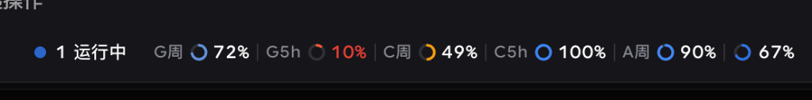
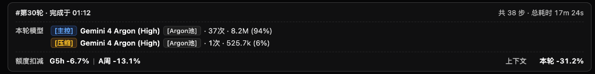
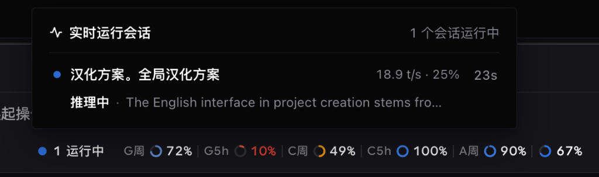
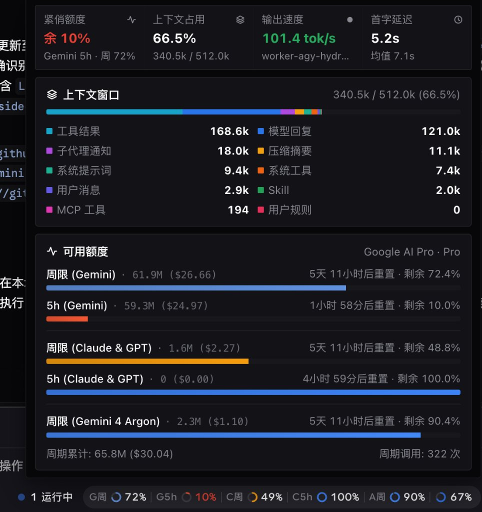

<div align="center">


# Antigravity Usage & Speed Monitor (Gemini 定制增强版)

Google Antigravity 2.0、Antigravity IDE 与 Antigravity CLI 的本地用量、速率、上下文与配额监控插件（基于 [`yuhuan-dev/antigravity-usage-monitor`](https://github.com/yuhuan-dev/antigravity-usage-monitor) 二次开发），无外部 npm 依赖。

[](https://github.com/tiantutu798-bit/Gemini/releases/tag/v1.6.0)
[](https://github.com/tiantutu798-bit/Gemini/stargazers)
[](LICENSE)
[](#本地开发)
[](#客户端支持)

[English](README.md) · **简体中文**

[**✨ 核心创新（置顶）**](#核心创新亮点置顶) · [四张实拍图](#1-四张核心实拍图) · [顶栏/输入栏双池额度](#2-输入框底部-6-槽常驻额度栏) · [蓝→橙黄→红渐变](#3-剩余量优先--蓝橙黄红连续渐变) · [每轮内联用量卡](#4-对话流每轮回答底部内联用量摘要卡) · [安装](#安装) · [功能](#功能) · [开发](#本地开发)

<br />



<br />

[下载源码压缩包 (`main.zip`)](https://github.com/tiantutu798-bit/Gemini/archive/refs/heads/main.zip) · [查看上游原仓库 (`yuhuan-dev/antigravity-usage-monitor`)](https://github.com/yuhuan-dev/antigravity-usage-monitor)

</div>

---

<a id="核心创新亮点置顶"></a>

## ✨ 核心创新亮点（置顶）

> [!IMPORTANT]
> 本项目是基于 [`yuhuan-dev/antigravity-usage-monitor`](https://github.com/yuhuan-dev/antigravity-usage-monitor)（`v1.5.1`）的 **GNU GPL v3.0 only 衍生修改版**（修改日期：2026-11）。项目完整保留原作者 `yuhuan-dev` 的版权声明、完整 Git 提交历史与 GPL-3.0 开源协议，并在此基础上开放以下核心交互与视觉创新。

<a id="1-四张核心实拍图"></a>

### 1. 四张核心实拍图

<table>
  <tr>
    <td align="center">
      
      <br />
      <b>① 输入框常驻 6 槽额度栏（实时多色圆环）</b>
      <br />
      <sub>无需切到 Usage 设置页：一排直观呈现 <code>G周 72%</code> | <code>G5h 10%</code> | <code>C周 49%</code> | <code>C5h 100%</code> | <code>A周 90%</code> | <code>上下文 67%</code>，余量越少圆环越红，一眼识别瓶颈</sub>
    </td>
  </tr>
  <tr>
    <td align="center">
      
      <br />
      <b>② 对话流每轮回答底部内联用量摘要卡（模型分身 · 额度扣减 · 上下文增减）</b>
      <br />
      <sub>每一次回答结束后在正下方自动生成本轮专属账单：清晰拆解 <code>[主控]</code> / <code>[执行]</code> / <code>[子代理]</code> / <code>[压缩]</code> 模型调用次数与占比、对应额度池真实扣减（如单独使用 Argon 时仅扣减 <code>A周 -13.1%</code>）以及本轮上下文净变化（如自动压缩后 <code>本轮 -31.2%</code>）</sub>
    </td>
  </tr>
  <tr>
    <td align="center">
      
      <br />
      <b>③ 实时运行会话浮窗联动（底栏常驻不遮挡）</b>
      <br />
      <sub>悬停或点击左侧「1 运行中」在输入框正上方展开当前生成速度（<code>18.9 t/s</code>）、占比与实时推理阶段，底部 6 槽额度圆环始终可见</sub>
    </td>
  </tr>
  <tr>
    <td align="center">
      
      <br />
      <b>④ 悬停速览卡 · 官方排序 + 剩余量条 + 双端同步渐变</b>
      <br />
      <sub>上方「可用额度」卡片严格对齐官方 Usage 顺序（Gemini 周/5h → Claude & GPT 周/5h → Argon 周），进度条长度与颜色和下方 5 个小圆环完全一致</sub>
    </td>
  </tr>
</table>

<a id="2-输入框底部-6-槽常驻额度栏"></a>

### 2. 顶栏 / 输入框常驻双池全量额度栏（`v1.6.0` 已适配最新双池体系）

相比上游原版只包含旧版单一配额提示、缺乏细粒度多池直观呈现，本版本重构了胶囊配额槽位与模型阵容适配：

- **统一适配最新「2 大池 · 4 项限额 + 上下文」**：随 Antigravity 2026-11-24 模型调整（Argon 合并回 Gemini 池、`Gemini 4 Neon` 全面上线），自动下线已失效的 `argon_weekly` (`A周 --%`)，一排直观显示 **`G周 | G5h | C周 | C5h | 上下文`**（支持 `MAX_TOPBAR_SLOTS = 6` 自定义扩展），全面支持停靠在顶部标题栏（`dual`）或底部输入框（`composer`）。
- **迷你圆形进度环 + 解除 `52px` 截断**：为 `G周`、`G5h`、`C周`、`C5h` 在百分比左侧嵌入与上下文指示器同款的 SVG 圆形进度环，并移除原版 `.wm-seg-quota` 的 `width: 52px` 裁切限制，彻底消除 `100%` 变成 `1...` 的省略号问题。
- **全模型识别无盲区**：完整覆盖 `Gemini 4 Neon`（`M532`~`M535` 四档思考枚举）、`Gemini 4 Carbon`、`Gemini 4 Hydrogen`、`Orchestrator Gemini 4 Carbon High` 与 `Claude Opus/Sonnet 5.5`、`GPT-OSS 120B`。

<details>
<summary>最新双池 5 槽配置参考（支持顶栏 dual 或输入框 composer 挂载）</summary>

```json
{
  "windowMountMode": "dual",
  "enableWindowOverlay": true,
  "topbarCapsuleSlots": [
    "gemini_weekly",
    "gemini_5h",
    "claude_weekly",
    "claude_5h",
    "context"
  ]
}
```

</details>

<a id="3-剩余量优先--蓝橙黄红连续渐变"></a>

### 3. 剩余量优先 + 蓝→橙黄→红连续渐变

为了在对话过程中不用看文字也能凭余光感知“还能用多少”，我们对进度条与色带逻辑做了整体重设计：

- **进度条长度直接表示「剩余量」**：
  - 上游原版进度条绑定的是“已用比例”（余 100% 时几乎是空条），本版本在 [`QuotaPoolsWidget.js`](sidecars/panel/src/components/widgets/QuotaPoolsWidget.js) 中改绑 `remainingPct`：**剩余 100% 即满格，剩余越少条越短**。
  - 右侧文字同步精简为只展示剩余百分比（`{reset} · 剩余 {rem}%`），去掉冗余的 `已用 ...`，与官方 Usage 面板及圆环百分比口径一致。
- **连续 RGB 插值渐变（告别生硬跳变）**：
  - 共享核心 [`resolveQuotaRemainingColor()`](sidecars/panel/src/core/formatters.js) 按剩余百分比在 5 个锚点之间连续线性插值，并同步驱动卡片横向进度条（`--fill-bg`）与输入框 5 个额度小圆环（`--ring-color`）：

| 剩余配额 | 对应十六进制色值 | 视觉含义 |
| :---: | :---: | :--- |
| **100%** | `#3b82f6` | 纯正主题蓝：额度满格充裕（对应上方 `C5h ○ 100%`） |
| **75%** | `#4e8ff7` | 柔和亮蓝：消耗初期，状态健康（对应上方 `G周 ○ 72%`、`A周 ○ 90%`） |
| **50%** | `#f59e0b` | 琥珀橙黄：已消耗过半，提醒留意节奏（对应上方 `C周 ○ 49%`） |
| **25%** | `#f97316` | 鲜明橙红：余量偏低，建议关注重置倒计时 |
| **0%** | `#ef4444` | 警示正红：即将见底，需要换池或等待重置（对应上方 `G5h ○ 10%`） |

- **上下文圆环独立清晰**：最右侧的上下文占用圆环（如 `○ 67%`）保留原版独立色阶逻辑，与左侧 5 个模型额度环互不混淆。

<a id="4-对话流每轮回答底部内联用量摘要卡"></a>

### 4. 对话流每轮回答底部内联用量摘要卡

在同一个长对话中连续提问数十次时，传统监控面板只能看到“全局累计”或密密麻麻的单步表格，很难一眼看出**“刚刚这一次提问到底调了哪些幕后模型、扣了我多少额度”**。为此我们新增了 [`TurnUsageCardWidget.js`](sidecars/panel/src/components/widgets/TurnUsageCardWidget.js)，在聊天流每一次已完成的 AI 回答正下方内联挂载三层高密度用量摘要卡：

<p align="center">
  
</p>

- **第一层 · 轮次定位与总耗时**：
  - 左侧显示真实对话轮次与完成时间（如 `#第30轮 · 完成于 01:12`），右侧汇总本轮后台工具链与推理共经历了多少步及总耗时（如 `共 38 步 · 总耗时 17m 24s`）。
- **第二层 · 本轮模型角色与额度池拆解（揭开黑盒路由）**：
  - 自动将本轮所有调用按 **角色标签**（蓝色 `[主控]`、绿色 `[执行]`、紫色 `[子代理]`、琥珀色 `[压缩]`）与 **所属额度池**（`[Gemini池]`、`[Claude/GPT池]`）归并排序。
  - 直观展示每个模型的调用次数、吞吐 Token 总量及本轮占比（兼容 `Gemini 4 Neon`、`Gemini 4 Carbon`、`Orchestrator Gemini 4 Carbon High` 与 `worker-agy-hydrogen`）。
- **第三层 · 本轮真实额度扣减与上下文净变化（带跨重置周期校准）**：
  - **额度扣减**：严格按照本轮实际调用的模型所属额度池与当前周期容量精确计算百分比扣减（Google 全系统一扣减 `G5h | G周`，第三方模型统一扣减 `C5h | C周`）；并内置跨配额重置周期校验与 `usedPct` 上限保护，确保新周期刚重置时旧历史轮次数值不会虚高。当前总剩余百分比直接看上方/下方常驻额度胶囊，上下分工明确、零重复信息。
  - **上下文净增减**：右侧展示本轮对话带来的主上下文窗口变化百分比（普通轮次显示如 `本轮 +4.8%`，当本轮触发自动上下文压缩释放空间时则直观显示负向释放量如 `本轮 -31.2%`）。
- **虚拟滚动 (`trajectorySlice`) 精确对齐 & 流式生成防闪烁**：
  - 通过读取宿主 DOM 节点的 React Fiber `container.steps[].metadata.createdAt` 时间戳与后端 `recentSteps` 精确匹配真实轮次序号，即使在数十轮长对话中上下滚动触发虚拟列表分页卸载/重挂载，轮次编号也绝不错位；当前正在流式输出的回答自动抑制挂载，回答完成后立即平滑呈现。

### 相对上游原版的完整改进清单

| 维度 | 上游原版 (`yuhuan-dev/antigravity-usage-monitor`) | 本定制增强版 (`tiantutu798-bit/Gemini` `v1.6.0`) |
| :--- | :--- | :--- |
| **每轮对话内联账单** | 无内联统计，需手动打开面板翻查单步表格，无单轮额度扣减换算 | **每次回答正下方自动挂载三层摘要卡**：展示 `[主控]/[执行]/[子代理]/[压缩]` 模型明细、**双池真实扣减 (`G5h / G周 / C5h / C周`)**（带跨重置周期保护）与 **本轮上下文净增减** |
| **最新模型与配额池** | `MODEL_PLACEHOLDER_M537` 易误判、缺 Neon 档位，未及时下线废弃 `A周` 死槽 | **完整收录 `Gemini 4 Neon` (`M532`~`M535`) 与新版 `Orchestrator Gemini 4 Carbon High`**；自动剔除失效 `argon_weekly`，对齐最新 **Gemini + Claude & GPT 双池** |
| **胶囊槽位与圆环** | 最多 5 项纯文字，长项易触发 `52px` 截断 | **支持最多 6 槽扩容**，4 路官方限额配齐同款 SVG 迷你圆环且永不截断 |
| **可用额度排序** | `Gemini → Argon → Claude & GPT`，组内 `5h` 在上、`周限` 在下 | **对齐官方 Usage**：`Gemini → Claude & GPT → Argon`，组内 **`周限` 在上、`5h` 在下** |
| **进度条与右侧文案** | 进度条按「已用比例」递增，文案同时显示已用与剩余 | 进度条直接展示 **「剩余比例」**，右侧精简为 **`剩余 XX.X%`** |
| **色彩预警机制** | 固定蓝 + 70%/85% 两档硬切换；底部文字圆环样式不统一 | **蓝 (`#3b82f6`) → 橙黄 (`#f59e0b`) → 红 (`#ef4444`) 连续渐变**，横条与 5 个圆环双端实时同步 |
| **模型归类准确度** | 部分新版 placeholder 未收录或 `Orchestrator` 标识误归类 | 补全 [`pricing-catalog.json`](pricing-catalog.json) (`v2026.11.24.1`) 与识别规则，准确识别 **`Gemini 4 Neon` / `Orchestrator (Neon/Carbon)`** |
| **macOS 2.33.0+ 启动** | 裸启动缺失 `--remote-debugging-port` 时需手动重拉 | 新增受保护的 `autoRelaunchDebug`，通过外部终端重拉并 **确认额度栏挂载成功后再等 3 秒自动关窗** |
| **插件清单名称** | 英文默认名称 | [`plugin.json`](plugin.json) 本地化显示名为「**用量与额度监控**」 |

---

## 功能

- **实时指标与版面编排**：统计单步输出速度（`tok/s`）、首字延迟（`TTFT`）、会话平均速度、单步/累计费用、缓存命中率、最紧缺配额与已用 Token；可在设置中从 9 项指标中自由勾选并拖拽排序（默认展示 4 项），并调整实时监控各模块顺序。
- **10 类上下文窗口构成**：展示最近一次请求的上下文占比，按占用列出模型回复、工具结果、用户消息、子代理通知、压缩摘要、系统提示词、系统工具、MCP 工具、Skill 与用户规则，支持在主代理与任意子代理之间切换查看。
- **配额池监控与过期提示**：追踪 `Gemini`、`Gemini 4 Argon`、`Gemini 4 Carbon` 与 `Claude & GPT` 配额池的 5 小时及每周余量、重置倒计时与周期累计用量；上游接口暂未返回新数据时保留缓存余量并显示陈旧提示。
- **主/子代理联动与多会话管理**：按时间归并展示主代理与各子代理调用步骤（也可按单一代理过滤），支持可选轮次分组导轨与运行中子代理卡片原地展开，并在顶栏切换最近会话。
- **调用明细与自定义 Token 格式**：包含「按步查看」与「按模型汇总」（含多模型拟合图）；支持增删与排序 2–14 列、独立开关速度分段配色，除预设的 `上下文 / 思考 / 正文` 和 `输入 / 输出 / 缓存` 外，可通过 `context:new:cache`、`in:out:cache` 等语法自定义 Token 组合展示。
- **历史用量与来源统计**：按今天、1 天、7 天、14 天、30 天、全部或自定义起止日期时间统计总 Token、新输入与缓存读取节省金额、输出/思考拆分、按小时/按天趋势折线图、模型排行、客户端来源（App / IDE / CLI）与月度柱状图。
- **多端胶囊与悬浮速览**：支持 Antigravity 2.0 顶栏/输入框停靠胶囊与右侧辅助栏、Antigravity IDE 顶栏/输入框胶囊、Antigravity CLI（`agy`）单行 24-bit ANSI `statusLine` 与独立 Web 页面；支持自定义 1–6 个胶囊指标槽位、悬停速览卡片内容以及自动适宽（或 `440~1080 px` 固定宽度）。
- **不修改 `app.asar`**：桌面端与 IDE 的胶囊挂载及上下文请求改写均在运行时通过本地 CDP 内存注入完成（IDE 首次启用时仅向 `~/.antigravity-ide/argv.json` 写入 `"remote-debugging-port": "0"`，保留注释与原有配置），不触碰宿主安装包与 `app.asar`。
- **按模型设置上下文窗口**：支持按模型系列（跨思考档位）统一指定上下文上限或跟随宿主默认；桌面端与 IDE 在请求层生效，CLI 通过环境变量 `AGY_CLI_AUTO_COMPACT_OVERRIDE` 控制。
- **外观定制、离线读取与云端同步**：提供简体中文 / English / 自动跟随宿主语言、`sm / md / lg / xl` 字号、6 种主题强调色（含跟随宿主主题）；离线支持直读 CLI SQLite + WAL、`annotations/*.pbtxt`、`transcript.jsonl` 与 `.deep_stats_cache.json`；内置 GitHub [`pricing-catalog.json`](pricing-catalog.json) 同步、压缩步骤模型推断、面板内更新（手动 / 自动 / 关闭）及缓存重建与配置重置。

---

## 截图

### 桌面端总览与更多场景

<table>
  <tr>
    <td align="center">
      
      <br />
      <b>Antigravity 2.0 桌面端总览</b>
      <br />
      <sub>顶部/输入框悬浮胶囊与点击展开的完整四标签监控弹窗</sub>
    </td>
  </tr>
  <tr>
    <td align="center">
      
      <br />
      <b>Antigravity IDE</b>
      <br />
      <sub>顶栏悬浮胶囊与速览浮窗，显示当前步骤费用、上下文占用与配额状态</sub>
    </td>
  </tr>
  <tr>
    <td align="center">
      
      <br />
      <b>Antigravity CLI (<code>agy</code>)</b>
      <br />
      <sub>终端底栏单行 24-bit ANSI 无背景色 <code>statusLine</code>，显示活跃会话数、输出速率、首字延迟与上下文占比</sub>
    </td>
  </tr>
</table>

### 面板标签页

<table>
  <tr>
    <td align="center" width="33.3%">
      
      <br />
      <b>实时监控</b>
      <br />
      <sub>输出速率、首字延迟、10 类上下文明细、配额池与运行中任务</sub>
    </td>
    <td align="center" width="33.3%">
      
      <br />
      <b>用量统计</b>
      <br />
      <sub>Token 汇总、缓存命中率、趋势曲线与分模型用量排行</sub>
    </td>
    <td align="center" width="33.3%">
      
      <br />
      <b>调用明细</b>
      <br />
      <sub>按步列出代理归属、模型、速率、首字延迟、Token 构成与费用</sub>
    </td>
  </tr>
</table>

---

## 客户端支持

| 客户端 / 运行环境 | 状态胶囊 / 底栏 | 监控面板 | 离线 SQLite 与日志读取 | 按模型上下文限制 | 修改 `app.asar` |
| :--- | :---: | :---: | :---: | :---: | :---: |
| **Antigravity 2.0 桌面端** | 顶栏 / 输入框停靠 | 悬浮窗 + 右侧辅助栏 | 支持 | 请求级重写钩子 | 否 |
| **Antigravity IDE** | 顶栏 / 输入框停靠 | 点击胶囊展开面板 | 支持 | 请求级重写钩子 | 否 |
| **Antigravity CLI (`agy`)** | 终端底栏 `statusLine` | 独立 Web (`--port`) | 支持（`node:sqlite` + `.pbtxt`） | `AGY_CLI_AUTO_COMPACT_OVERRIDE` | 否 |
| **无头服务器 / SSH 远程** | 终端底栏 `statusLine` | SSH 隧道 / `--token` Web | 支持 | `AGY_CLI_AUTO_COMPACT_OVERRIDE` | 否 |

> [!NOTE]
> 在 **Antigravity IDE** 中首次启用插件时，后台会通过零工具开销的 MCP 保活入口（不消耗上下文 Token）向 `~/.antigravity-ide/argv.json` 写入 `"remote-debugging-port": "0"`（保留原有注释与配置项）。首次启用后需重启一次 IDE，顶栏胶囊才能正常挂载。

---

## 安装

插件目录名需保持为 `usage-monitor`，**无需运行 `npm install`**。

### 方式一：Git 克隆

```powershell
# Windows PowerShell
git clone https://github.com/tiantutu798-bit/Gemini.git "$env:USERPROFILE\.gemini\config\plugins\usage-monitor"
```

```bash
# macOS / Linux
git clone https://github.com/tiantutu798-bit/Gemini.git ~/.gemini/config/plugins/usage-monitor
```

也可以直接在 Antigravity 对话中执行：

```text
把 https://github.com/tiantutu798-bit/Gemini 克隆到 ~/.gemini/config/plugins/usage-monitor 并启用插件
```

### 方式二：下载源码压缩包

下载 [`main.zip`](https://github.com/tiantutu798-bit/Gemini/archive/refs/heads/main.zip)，解压到 `~/.gemini/config/plugins/` 下并将解压后的文件夹名重命名为 `usage-monitor`（完整路径为 `~/.gemini/config/plugins/usage-monitor`）。

<details>
<summary>Windows PowerShell 下载与解压命令</summary>

```powershell
$pluginsDir = "$env:USERPROFILE\.gemini\config\plugins"
New-Item -ItemType Directory -Path $pluginsDir -Force | Out-Null
Invoke-WebRequest -Uri "https://github.com/tiantutu798-bit/Gemini/archive/refs/heads/main.zip" -OutFile "$env:TEMP\Gemini-main.zip"
Expand-Archive -Path "$env:TEMP\Gemini-main.zip" -DestinationPath $pluginsDir -Force
Remove-Item -Path "$pluginsDir\usage-monitor" -Recurse -Force -ErrorAction SilentlyContinue
Rename-Item -Path "$pluginsDir\Gemini-main" -NewName "usage-monitor"
```

</details>

---

## 使用方式

1. 打开左侧边栏 **Customizations → Installed**，找到 `usage-monitor` 并开启。
2. **Antigravity 2.0 桌面端**：
   - 主窗口右上角挂载悬浮胶囊（**悬停**查看速览，**左键**打开四标签面板，**右键**强制刷新），同时可在右侧辅助栏打开「用量监控」。
3. **Antigravity IDE**：
   - 首次启用后**重启一次 Antigravity IDE**，保持挂载方式为「双栖挂载」，点击顶栏胶囊即可打开面板。
4. **Antigravity CLI (`agy`) 底部胶囊**：
   - 检测到 `~/.gemini/antigravity-cli` 时自动写入原生 `statusLine` 配置（保留已有自定义 `statusLine.command`），在终端底栏单行显示当前活跃状态、输出速率、首字延迟与上下文占比（如 `● 1 运行中   38.1 t/s | 0.85s | ◎ 17%`）。
   - 可在 `agy` 中通过 `/statusline` 或在面板 **偏好设置 → 界面编排 → 挂载胶囊** 开关及调整显示顺序。
5. **独立 Web 服务（纯终端 / 远程服务器）**：

```bash
# 1. 在远程服务器上启动（默认监听 127.0.0.1:8787）
node ~/.gemini/config/plugins/usage-monitor/sidecars/panel/standalone.mjs --port 8787

# 2. 本地端口转发后，浏览器访问 http://localhost:8787
ssh -L 8787:127.0.0.1:8787 user@your-server
```

<details>
<summary>独立 Web 命令行参数、随 agy 自动启动与非回环令牌校验</summary>

- **随 `agy` 自动启动**：设置环境变量 `USAGE_MONITOR_STANDALONE_PORT=8787`，或在 `~/.gemini/antigravity-cli/sidecar_data/usage-monitor/panel/data/settings.json` 中添加 `"standalonePort": 8787`，插件随 MCP 进程启动时会自动拉起 Web 服务。
- **非回环访问校验**：绑定 `0.0.0.0` 或局域网 IP 时必须提供 `--token <密钥>`（或环境变量 `USAGE_MONITOR_STANDALONE_TOKEN`），未设置令牌会拒绝启动。
- **常用参数**：支持 `--data-dir`、`--app-data-dir`、`--gemini-dir`、`--ls-addr` 与 `--csrf-token`。
- **离线数据读取**：在 `agy` 未运行的状态下，后台直接读取 `~/.gemini/antigravity-cli` 下的 `conversation_summaries.db`、`conversations/*.db`、`annotations/*.pbtxt` 与 `transcript.jsonl`，待 `agy` 启动后自动切换为实时 RPC 数据。

</details>

---

## 配置说明与计算口径

<details>
<summary>界面与字段配置（挂载方式、胶囊槽位、Token 组合格式、模型命名与上下文限制）</summary>

- **挂载模式与浮窗宽度**：支持「双栖挂载（顶部栏 + 侧边栏）」、「输入框挂载」与「仅侧边栏」；悬浮窗默认使用「自动适配」（宽表格下在窗口范围内自动加宽），也可设置为 `440~1080 px` 固定宽度。
- **胶囊槽位**：支持在 1 至 6 个指标间增删与排序（支持 Gemini / Claude & GPT / Argon 额度环与输出速度、首字延迟、上下文占用等指标），并可单独开关运行中会话指示器。
- **调用明细与 Token 组合**：在「界面编排 → 调用明细字段」可分别开关主/子代理标识、对话轮次导轨（默认关闭）与输出速度多色分级（默认关闭）；Token 列默认显示 `上下文 / 思考 / 正文`，可切换至 `输入 / 输出 / 缓存` 预设（悬停显示美元分项），或使用 `context:new:cache`、`in:out:cache` 等自定义格式字符串。
- **模型命名格式**：支持精简代号（如 `argon-4-high`）、原始模型 ID 与去前缀原始 ID（去掉 `gemini-` / `claude-` / `gpt-` 前缀并保留 `·压缩` 标记）三档；Orchestrator 系列支持单独设置。
- **按模型设置上下文窗口**：在「其他 → 模型上下文设置」中为同一模型的各推理档位设置统一上限或「跟随宿主设置」。App / IDE 会在启动后作用于后续请求；CLI 通过 `AGY_CLI_AUTO_COMPACT_OVERRIDE` 控制。

</details>

<details>
<summary>模型识别、压缩步骤推断与费用折算说明</summary>

- **模型识别规则**：直接读取当前步骤的原始用量字段与对应生成记录，已记录的模型不会被后续推断覆盖。当上下文压缩步骤缺少模型字段时，按同一会话内「先向前、后向后，优先同提供方、再放宽匹配」的顺序推断用于展示与费用估算；无可推断来源时标注为「模型未知·压缩」。
- **费用计算口径**：模型或价格项未匹配时，单步费用记为「待定」，Token 数量仍正常统计；汇总金额仅累加已确认单价的步骤。美元金额基于 [`pricing-catalog.json`](pricing-catalog.json) 中的公开 API 单价估算，仅供本地对比参考，不代表订阅配额扣减比例。
- **升级校验与均速口径**：插件升级后会按原始轨迹重新校验旧缓存，同时保留既有 Token 与有效计时；压缩步骤在调用明细中展示完整请求 TPS，但不会计入会话平均生成速度与平均首字延迟。

</details>

<details>
<summary>更新方式与本地数据目录</summary>

- **面板内检查更新**：检测到 GitHub 新版本时，胶囊旁与面板顶栏会显示更新标记，点击后拉取更新并自动重载；可在 **偏好设置 → 其他** 选择「手动提示 / 自动更新 / 关闭」，或手动同步价格表。
- **Git 手动更新**：
  - Windows：`git -C "$env:USERPROFILE\.gemini\config\plugins\usage-monitor" pull --ff-only`
  - macOS / Linux：`git -C ~/.gemini/config/plugins/usage-monitor pull --ff-only`
  - 更新后在 **Customizations → Installed** 重新开关一次插件生效。
- **数据目录**：缓存与设置保存在 `~/.gemini/antigravity/sidecar_data/usage-monitor/`（独立模式未指定 `ANTIGRAVITY_EXECUTABLE_DATA_DIR` 时存放在 `sidecars/panel/.data/`），升级插件不会清除历史记录。

</details>

---

## 本地开发

前后端代码采用纯 Node.js ESM 与原生 Web Components 编写，**无外部 npm 依赖**（建议使用 Node.js 22.5+ 以使用内置 `node:sqlite`）。

```bash
cd sidecars/panel

# 修改 src/ 下源码后重新构建 app.js 与 styles.css
npm run build

# 运行单元测试与回归测试
npm test
```

## 参与贡献、鸣谢与开源协议

欢迎提交 Issue 或 Pull Request。若修改了 `sidecars/panel/src/` 下的前端源码，请先执行 `npm run build` 重新生成产物，并确保 `npm test` 全部通过。

- 上游原项目：[`yuhuan-dev/antigravity-usage-monitor`](https://github.com/yuhuan-dev/antigravity-usage-monitor)（`Copyright (C) 2026 yuhuan-dev`）
- 本衍生修改版及全部新增/改动部分同样严格遵守 [GNU General Public License v3.0 only (GPL-3.0-only)](LICENSE) 开源协议。
